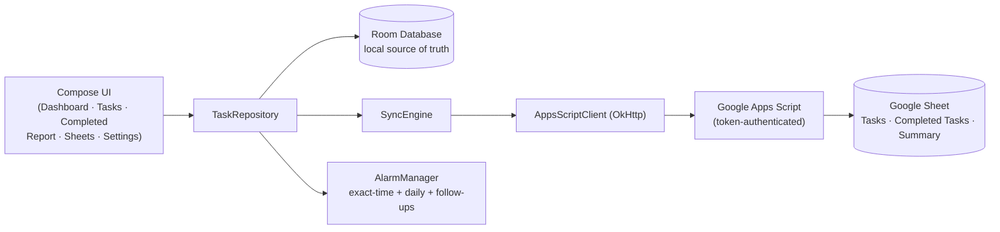

<div align="center">

# ✅ Task Tracker Pro

**A production-grade, local-first task manager for Android — with optional Google Sheets sync.**


</div>

---

## 📖 Overview

Task Tracker Pro manages real-world work — tasks with vendors, costs, deadlines and follow-ups — in a clean, iOS-inspired interface. It is **fully functional offline**: all data lives on the device in a local database. An **optional** two-way sync with Google Sheets (via Apps Script) can be connected separately whenever you want a cloud copy — the app never requires it.

Every task carries **21 structured fields**: name, type, progress, priority, deadline, vendor/craftsman, contact, estimated & actual cost (₹), follow-up date, delivery date, payment status, links, focus, value-add, notes and full timestamps.

## ✨ Key Features

**Task management**
- Dashboard with today's work, overdue alerts and a **Smart Next Action** suggestion
- Pending tasks and completed tasks kept **strictly separate** — in the app and in the sheet
- Search, filters, and a full 21-field detail view for every task
- One-tap **Call** and **WhatsApp** actions from the task's contact number
- **Share** a formatted task summary to WhatsApp or any app

**Reminders & notifications**
- Daily pending-task digest at a time you choose
- **Exact-time reminder per task** — fires on the minute (alarm-clock grade scheduling)
- Per-task **follow-up alerts** when a follow-up date arrives
- **Done button right inside the notification** — completes the task without opening the app

**Money (Kharcha)**
- In-app cost summary: totals, amount due, and **vendor-wise dues**
- Daily report with a money section; amounts formatted in Indian style (₹12,34,567)

**Google Sheets sync (optional)**
- Two-way sync with a dedicated spreadsheet: `Tasks` tab for pending work, a separate `Completed Tasks` tab, and an auto-maintained **`Summary` tab** (totals, progress buckets, overdue counts, money, vendor-wise dues)
- Near real-time: local changes upload within ~2 seconds; sheet changes are picked up every ~15 seconds
- Safe by design: stable UUIDs (never row numbers), conflict rule *"local unsynced edits win"*, and remote deletions applied only after a validated complete snapshot

**Data safety**
- JSON **backup & restore** (merge-only import; credentials are never exported)
- No account, no login, no tracking — your data stays yours

## 🧱 Architecture



| Layer | Technology |
|---|---|
| Language | Kotlin |
| UI | Jetpack Compose + Material 3 (custom iOS-style design system) |
| Local storage | Room (SQLite), DataStore, EncryptedSharedPreferences |
| Networking | OkHttp + org.json |
| Backend (optional) | Google Apps Script Web App → Google Sheets |
| Reminders | AlarmManager (`setAlarmClock`), boot-rescheduled |
| Build | Gradle 8.7, AGP 8.5.2, minSdk 26 / targetSdk 34 |

## 📊 Sheet Schema (21 columns, exact order)

`ID · Task Name · Type · Progress · Priority · Deadline · Vendor / Craftsman · Contact Number · Estimated Cost (INR) · Actual Cost (INR) · Next Follow-up · Delivery Date · Payment Status · Link · Task Focus · Value Add · Notes · Task Added · Task Started · Task Completed · Last Updated`

Amount-due rule (identical in app and sheet): if Payment Status is not `Paid`, due = Actual Cost when given, otherwise Estimated Cost.

## 🚀 Getting Started

### Install the APK
1. Download the latest debug APK (shared by the maintainer, or build it yourself below).
2. Open it on any Android 8.0+ phone and allow "Install from unknown sources" if asked.
3. No sign-up — the app works immediately, fully offline.

### Build from source
```bash
git clone https://github.com/roh4n-13/muse-taskapp.git
cd muse-taskapp
# Requires JDK 17 and the Android SDK (compileSdk 34)
gradle testDebugUnitTest assembleDebug   # or open in Android Studio
```
The debug APK is produced at `app/build/outputs/apk/debug/app-debug.apk`.

### Connect Google Sheets sync (optional)
1. Create a **new, dedicated** spreadsheet for the app (never point it at a sheet with other data).
2. In that sheet: **Extensions → Apps Script**, paste `apps-script/Code.gs`, set a `SECRET_TOKEN` under *Project Settings → Script Properties*, then **Deploy → New deployment → Web app**.
3. In the app: **Sheets tab** → paste the Web App URL and the same token → **Test Connection** → **Save** → turn on **Enable sync** → pick a first-sync strategy (Merge is safest).
4. Full details: [`apps-script/DEPLOY_NOTES.md`](apps-script/DEPLOY_NOTES.md). After any script change, deploy a **New version** for it to take effect.

## 🧪 Testing

**133 unit tests, all passing** — covering the sync engine (conflicts, deletions, first-sync strategies), date handling, cost & due calculations, follow-up logic, reminder planning, task sharing and list visibility.

```bash
gradle testDebugUnitTest
```

## 🔒 Privacy

- Local-first: nothing leaves the device unless **you** enable Sheets sync.
- The sync token is stored encrypted on-device and is never committed to this repository.
- Backups contain tasks only — never credentials.

## 🗣️ Hinglish me samjho

App bilkul simple hai: task banao, deadline lagao, reminder khud aa jayega. Kaam ho jaye to notification se hi **Done** daba do — task Completed me chala jayega. Vendor ke paise ka hisaab **Kharcha** card me dikhta hai. Aur agar Google Sheet se jodna hai to upar wala "Connect Google Sheets sync" section follow karo — bina uske bhi app pura chalta hai.

---

<div align="center">
<sub>Built with Kotlin & Jetpack Compose · Task Tracker Pro</sub>
</div>
